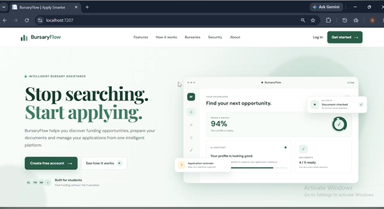

# BursaryFlow

**Stop searching. Start applying.**

BursaryFlow is a platform that helps students discover funding opportunities, prepare their documents, and manage their bursary applications in one place, making the process smarter, simpler, and quicker.

> 🚧 **Project status: work in progress.** BursaryFlow is under active development and not yet ready for public use. Features described below are a mix of what is being built and what is planned. See the [Roadmap](#roadmap) for where things currently stand.



---

## The Problem

Applying for bursaries in South Africa is often slow and overwhelming. Students have to:

- Search across many websites to find bursaries they might qualify for
- Work out each bursary's requirements and deadlines
- Gather, check, and resubmit the same documents again and again
- Keep track of multiple applications with no central view

Many students miss out on funding not because they don't qualify, but because the process is hard to navigate.

## The Idea

BursaryFlow aims to take a student from "where do I even start?" to "my application is ready" by bringing the whole process together:

- **Discover**: surface bursaries that are relevant to a student's profile
- **Understand**: make requirements clear instead of buried in long PDFs
- **Prepare**: organise and check the documents each application needs
- **Manage**: keep track of applications, deadlines, and reminders in one dashboard

## Planned Features

| Feature | Description | Status |
|---|---|---|
| Landing page | Public-facing introduction to BursaryFlow | 🟡 In progress |
| Student accounts | Sign up, log in, and manage a profile | 🔲 Planned |
| Bursary discovery | Browse and filter available bursaries | 🔲 Planned |
| Profile matching | Show how well a student's profile fits a bursary | 🔲 Planned |
| Document organiser | Store documents and track which are ready | 🔲 Planned |
| Document checking | Flag missing or incomplete documents | 🔲 Planned |
| Application tracking | Monitor progress across applications | 🔲 Planned |
| Reminders | Deadline and follow-up notifications | 🔲 Planned |
| AI assistant | Guidance on improving application readiness | 🔲 Planned |

## Tech Stack

- **Backend:** C# with ASP.NET Core (MVC: Controllers, Models, Views, Services)
- **Frontend:** Razor Views, HTML, CSS, JavaScript
- **Database:** SQL database with scripts included in the repo, accessed through the `Data` layer
- **Tools:** Visual Studio, Git, GitHub

### Project Structure

```
BursaryFlow/
├── Controllers/   # Handle incoming requests
├── Models/        # Data models
├── Data/          # Database access / context
├── Services/      # Business logic
├── Views/         # Razor pages (UI)
├── css/ js/ lib/  # Static assets
├── Program.cs     # App entry point and configuration
└── appsettings.json
```

## Getting Started

**Prerequisites:** [.NET SDK](https://dotnet.microsoft.com/download) and a SQL database server.

```bash
# 1. Clone the repository
git clone https://github.com/deltonovel-cell/BursaryFlow.git

# 2. Move into the project folder
cd BursaryFlow

# 3. Set your database connection string in appsettings.json

# 4. Restore dependencies and run
dotnet restore
dotnet run
```

The app currently runs locally at `https://localhost:7207`. Setup steps will be refined as the project matures.

## Roadmap

- [x] Define the problem and project vision
- [x] Design the landing page and brand direction
- [ ] Finalise system design and database structure
- [ ] Build authentication and student profiles
- [ ] Build the bursary listing and discovery features
- [ ] Build document upload and organisation
- [ ] Add application tracking and reminders
- [ ] Explore AI-assisted features
- [ ] Testing and security review
- [ ] Public launch

## What I'm Learning

Building BursaryFlow has been a lesson that software development is about more than writing code. It's about taking a real problem, breaking it down, designing the system, trying different solutions, failing, and learning from it. Some of the biggest challenges so far have been:

- Designing the system architecture and database
- Deciding how different features should work together
- Turning ideas into practical, working code

I'm building this in public, so progress, mistakes, and lessons will be shared along the way.

## Contributing

BursaryFlow is still in the early stages, but feedback is very welcome, especially from students who have been through the bursary application process. If you have ideas, suggestions, or spot something that could be better, feel free to open an issue.

## Author

**[Your Name]**
Computer Science student | South Africa
🔗 [LinkedIn](https://www.linkedin.com/in/[your-profile]) · 💻 [GitHub](https://github.com/deltonovel-cell)

---

*#BursaryFlow #EdTech #BuildInPublic #SouthAfrica #LearningToCode*
